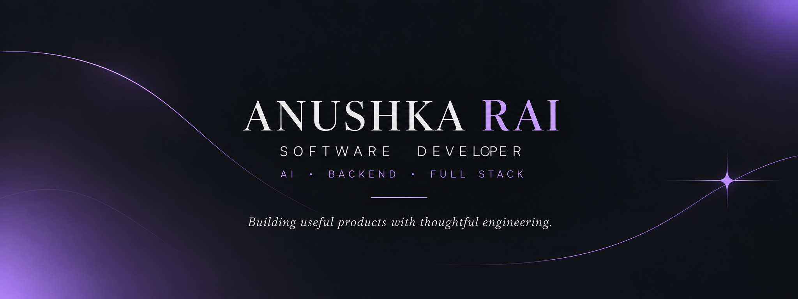

 

# ANUSHKA RAI

### SOFTWARE DEVELOPER · AI · BACKEND · FULL STACK

*Building thoughtful software at the intersection of engineering and AI.*

 

  

`Artificial Intelligence` ✦ `Backend Engineering` ✦ `Full-Stack Development`

---

## ☾ ABOUT ME

I'm a software developer interested in building products that combine intelligent systems with reliable engineering.

I enjoy working across the stack, exploring AI-powered workflows, solving problems, and turning ideas into practical applications.

- ✦ Interested in AI engineering, backend systems, and full-stack development.
- ✦ Enjoy building products from concept to implementation.
- ✦ Believe in ownership, accountability, and continuous learning.
- ✦ Always exploring new technologies and better ways to build.

> Curiosity first. Ownership always. Build, test, improve.

---

## ✧ TECH STACK

### Languages

### Frontend Development

### Backend Development

### Databases

### Tools & Infrastructure

 

---

## ☽ PROJECT ARCHIVE

*A collection of projects spanning AI, backend engineering, full-stack development, data visualization, and problem solving.*

<table>
<tr>
<td width="50%" valign="top">

### ◈ [DIVA](https://github.com/Anushkarai3A/DIVA)

**AI-Powered Deviation Intake**

An AI-powered deviation intake application designed for pharmaceutical API manufacturing. Extracts structured information from uploaded documents or pasted text and assists with impact assessment.

**Tech Stack**

`React` `TypeScript` `Vite` `Redux` `Python` `FastAPI` `LangGraph` `PostgreSQL` `Groq`

</td>
<td width="50%" valign="top">

### ◈ [EcoSphere](https://github.com/Anushkarai3A/EcoSphere)

**Gamified Environmental Education**

A location-based environmental education platform where students complete real-world environmental quests, submit geotagged evidence, and earn experience points and badges.

**Tech Stack**

`React` `TypeScript` `Vite` `Tailwind CSS` `Node.js` `Express` `Prisma` `PostGIS` `Redis` `FastAPI` `OpenCV` `YOLOv8`

</td>
</tr>

<tr>
<td width="50%" valign="top">

### ◈ [NexusAI](https://github.com/Anushkarai3A/NexusAI)

**AI Interview Preparation**

An AI-powered interview preparation application designed to help users practice interviews through interactive experiences and speech-enabled functionality.

**Tech Stack**

`JavaScript` `React` `Web Speech API` `JWT` `Role-Based Access`

</td>
<td width="50%" valign="top">

### ◈ [Realtime-Analytics-Dashboard](https://github.com/Anushkarai3A/Realtime-Analytics-Dashboard)

**Real-Time Data Visualization**

A real-time analytics dashboard built around streaming updates and interactive data visualization.

**Tech Stack**

`JavaScript` `React` `Socket.IO` `WebSockets` `Recharts`

</td>
</tr>

<tr>
<td width="50%" valign="top">

### ◈ [SkillSwap](https://github.com/Anushkarai3A/SkillSwap)

**Peer-to-Peer Learning Marketplace**

A platform for people to exchange skills, connect with other learners, arrange learning sessions, and communicate through real-time features.

**Tech Stack**

`MERN` `React` `Node.js` `Express` `MongoDB`

</td>
<td width="50%" valign="top">

### ◈ [bank-api](https://github.com/Anushkarai3A/bank-api)

**Indian Bank & Branch REST API**

A REST API for retrieving, searching, and exploring Indian banks and their branches using IFSC codes, with pagination and automated testing.

**Tech Stack**

`Python` `FastAPI` `PostgreSQL` `SQLAlchemy` `Pytest`

</td>
</tr>

<tr>
<td width="50%" valign="top">

### ◈ [steer-ai-pipeline](https://github.com/Anushkarai3A/steer-ai-pipeline)

**AI Research-to-Content Pipeline**

An AI-powered pipeline that transforms scientific papers into evidence-backed social media carousels, static posts, reels, and editable PowerPoint presentations, with traceable claims.

**Tech Stack**

`Python` `AI` `Content Generation` `Research Automation`

</td>
<td width="50%" valign="top">

### ◈ [steer-quiz](https://github.com/Anushkarai3A/steer-quiz)

**Interactive Educational Experience**

A mobile-first educational experience that simplifies complex health topics through engaging storytelling, intuitive visuals, and science-backed insights.

**Tech Stack**

`TypeScript` `Interactive UI` `Educational Technology`

</td>
</tr>

<tr>
<td width="50%" valign="top">

### ◈ [LeetCode-Solutions](https://github.com/Anushkarai3A/LeetCode-Solutions)

**Data Structures & Algorithms**

A collection of coding problem solutions focused on improving algorithmic thinking, problem-solving skills, and data structures knowledge.

**Tech Stack**

`Java` `Data Structures` `Algorithms`

</td>
<td width="50%" valign="top">

### ◈ [SmartParkingSystem](https://github.com/Anushkarai3A/SmartParkingSystem)

**Smart Parking Management System**

A Java-based project exploring software solutions for parking management.

**Tech Stack**

`Java`

</td>
</tr>
</table>

---

## ✦ GITHUB STATISTICS

  

  

---

## ✦ CURRENTLY EXPLORING

`AI Engineering` ✦ `LLM Applications` ✦ `Backend Architecture`

 

`Intelligent Workflows` ✦ `Full-Stack Products` ✦ `Problem Solving`

---

### *"Stay curious. Build things that matter."*

 

Building with intention. Learning continuously. Taking ownership.

 

  

